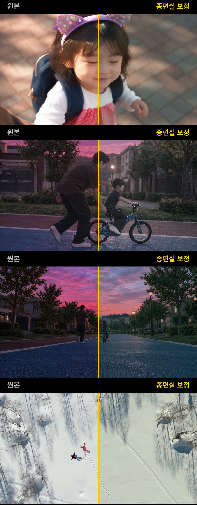

# 종편실 FinishRoom

**기준 영상 하나만 넣으면, 다른 영상들의 색감과 느낌을 그대로 맞춰 주는 무료 웹 색보정 도구입니다.**
설치도, 회원가입도 없습니다. 영상은 내 컴퓨터 안에서만 처리되고 어디에도 올라가지 않습니다.

👉 **바로 쓰기: https://totaldc200-lab.github.io/finishroom/**

## 이렇게 씁니다
1. **기준 넣기**: 따라 하고 싶은 느낌의 영상이나 스크린샷
2. **보정할 영상 넣기**: 여러 개를 한 번에 넣어도 됩니다
3. **느낌 강도 정하고 저장**

## 이런 때 좋습니다
- 카메라·렌즈가 달라 클립마다 색이 다를 때 하나의 톤으로 통일
- 좋아하는 영화·드라마 장면의 색감을 내 영상에 입히기
- AI로 만든 영상(힉스필드 등)을 실사 영상과 같은 톤으로 맞추기

## 특징
- 장면이 바뀌는 곳을 자동으로 찾아 장면마다 따로 맞춥니다
- 기준 영상의 **내용이 아니라 색보정만** 옮깁니다. 밝은 눈 장면은 밝게 유지됩니다
- 그림자·하이라이트 색 분리, 피부색 보호, 색 넘침 처리
- 자동 검수: 피부색이나 하이라이트가 망가질 것 같은 장면은 약하게 적용하고 알려 줍니다
- MP4, MOV, ProRes, 10비트 HEVC(아이폰·AI 영상) 지원
- 한국어 · English · 中文

크롬, 엣지, 사파리에서 동작합니다.

---

## English
**FinishRoom matches every clip to your reference look — free, in the browser, nothing to install.** Your videos never leave your computer.

Add a reference (a video or screenshots), add the clips to correct, set the strength and save. It detects scene cuts, moves only the grade (not the content), protects skin tones and highlights, and checks every scene automatically. Reads MP4/MOV incl. ProRes and 10-bit HEVC.

## Third-party
- [Mediabunny](https://mediabunny.dev) (MPL-2.0), loaded from jsDelivr
- HEVC decoder: FFmpeg via libav.js (`@suemor/libav-hevc`, LGPL-2.1), embedded as WebAssembly — see `licenses/`
